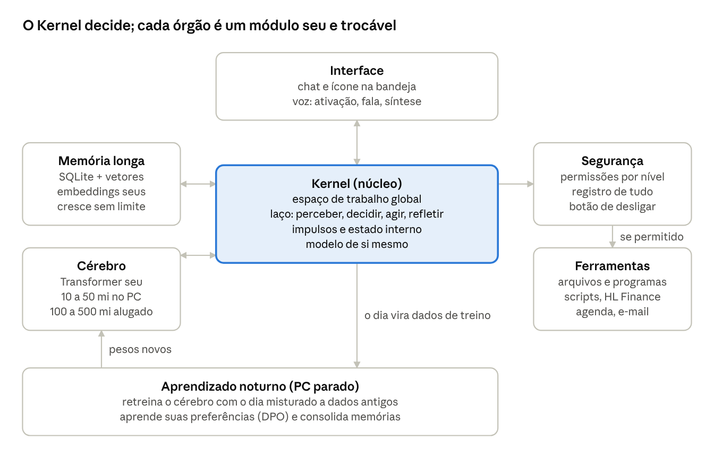
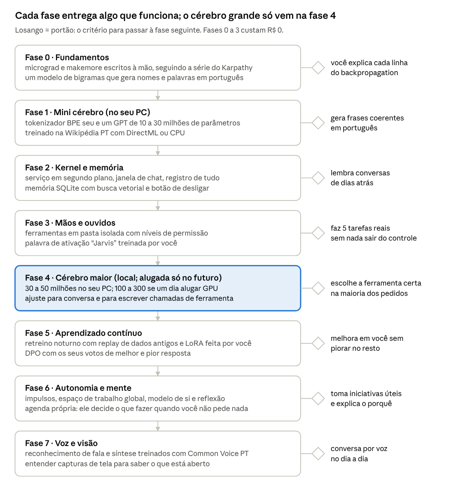

# K.E.R.N.E.L: plano do Jarvis pessoal

12 de outubro de 2026 · Henrique Lima

> Transcrição do plano original ([plano-original.pdf](plano-original.pdf)) para viver junto do código.
> O nome da IA é **K.E.R.N.E.L — Kinetic Extended Resolution Network and Evolutionary Logic**.
> Onde o plano diz palavra de ativação "Jarvis", o código usa a palavra configurada em `kernel.toml` (padrão: "kernel").

## Resumo: o que dá para fazer no seu PC

Dá para construir o Jarvis inteiro do zero no seu PC, mas o cérebro local vai ser pequeno: algo entre 10 e 50 milhões de parâmetros, treinado em casa. Um cérebro maior (100 a 500 milhões) é viável treinando em GPU alugada por algumas horas e rodando no seu PC depois.

A boa notícia é que a maior parte do que faz um Jarvis parecer inteligente não é o tamanho do cérebro. É a memória, as ferramentas, o laço de decisão e o aprendizado contínuo, e tudo isso roda bem no seu hardware.

O teto honesto: nenhum modelo treinado nesse hardware, ou mesmo com algumas centenas de reais de GPU alugada, chega perto de Claude ou GPT em raciocínio. Ele pode ficar muito bom em você: seus arquivos, sua rotina, seus comandos, seu jeito de falar.

| Peça | Seu hardware | O que isso significa |
|---|---|---|
| GPU | RX 570 4 GB. Sem CUDA. O ROCm (o "CUDA da AMD") abandonou essa geração (Polaris) há anos, e no Windows nunca suportou | Treino na GPU só via DirectML (torch-directml) no Windows, mais lento e com menos operações suportadas. Para rodar (inferência), Vulkan funciona bem |
| VRAM | 4 GB. Pesos, gradientes e estado do otimizador ocupam cerca de 16 bytes por parâmetro | Treino local cabe até uns 30 a 50 milhões de parâmetros com lote pequeno. Para rodar, cabe um modelo de até ~1 bilhão quantizado |
| Poder de cálculo | ~5 TFLOPS em FP32, sem ganho real com FP16 nessa placa | Um modelo de 30 milhões treinado em ~600 milhões de tokens leva por volta de 1 a 3 dias de PC ligado (estimativa) |
| RAM | 12 GB. Apertado para dados e treino ao mesmo tempo | Dados precisam ficar em disco, lidos aos pedaços (arquivos memmap). 32 GB seria um alívio grande e barato |
| HD | 500 GB. Espaço suficiente, mas HD mecânico é lento para leitura aleatória | Guardar os dados já tokenizados em arquivos binários sequenciais resolve quase tudo |

Um ponto para você decidir: o resto do sistema (memória, ferramentas, laço de autonomia, voz, segurança, aprendizado) pode ser 100% seu e do zero, com o cérebro sendo uma peça trocável. Assim você pode, se quiser, plugar temporariamente um modelo aberto enquanto o seu cresce, e trocar pelo seu quando ele ficar bom. Você disse que quer tudo do zero, então isso fica como opção, não como recomendação.

## Decisões do Henrique (12/10)

O plano agora é 100% local: Windows 10, cérebro só seu, sem GPU alugada por enquanto, e todos os órgãos exercitados desde o início.

| Pergunta | Resposta | O que muda no plano |
|---|---|---|
| Sistema | Windows 10 | Treino na GPU via torch-directml. Conferir na instalação qual versão do Python ele suporta e usar essa |
| Programação | Já mexeu com Python; o código será escrito com o Claude Code | Cada módulo fecha com você lendo, rodando e mudando algo nele, mais um teste simples. Assim o cérebro continua sendo seu de verdade |
| GPU alugada | Não, por enquanto | Teto do cérebro: 30 a 50 milhões de parâmetros, com treinos longos de madrugada. A fase 4 vira "esticar o local" (mais dados, mais tempo, quantização). Alugar fica para o futuro |
| Cérebro | 100% seu | Nenhum modelo aberto. Para compensar o cérebro pequeno, comandos críticos ("abrir X", "lembrar Y") passam por um classificador pequeno treinado por você, e o cérebro cuida da conversa |
| Prioridade | Todos os órgãos | Começar com uma "fatia vertical": um Jarvis v0.1 com cada órgão em versão mínima, depois melhorar todos em rodadas |

**Jarvis v0.1, a primeira rodada** (substitui a ordem estrita das fases 0 a 3; tudo roda no seu PC):

1. **Kernel:** serviço em segundo plano, janela de chat, registro de tudo e botão de desligar.
2. **Cérebro:** micrograd e bigramas para aprender, depois um mini GPT de 1 a 5 milhões de parâmetros na Wikipédia PT (treina em horas, não dias).
3. **Memória:** SQLite com busca por palavras escrita por você (BM25); vetores entram na segunda rodada.
4. **Mãos:** três ferramentas (abrir programa, listar pasta, anotar lembrete), cada ação pedindo confirmação.
5. **Ouvidos:** palavra de ativação "Jarvis" treinada com umas 200 gravações da sua voz.
6. **Mente:** dois impulsos (curiosidade e organização) e um diário onde ele reflete sobre o dia.
7. **Voz de saída:** fica para a segunda rodada, com um sintetizador pequeno seu.

Na segunda rodada cada órgão cresce: cérebro de 10 a 30 milhões, embeddings e busca vetorial, mais ferramentas, reconhecimento de comandos por voz, mais impulsos e o espaço de trabalho global.

## Autonomia e "consciência simulada"

Autonomia de verdade dá para construir; consciência de verdade, ninguém sabe construir, nem com supercomputador. O que dá para fazer é implementar os mecanismos que as principais teorias associam à consciência e observar o comportamento que sai disso. É um campo de pesquisa real e um ótimo projeto.

**Escolhas próprias (autonomia).** Isso não depende de um cérebro gigante. Depende de um laço que roda sozinho:

1. Perceber: ler eventos (horário, arquivos novos, janela aberta, o que você disse).
2. Lembrar: buscar memórias relevantes.
3. Avaliar: comparar a situação com objetivos e "impulsos" internos.
4. Decidir: escolher uma ação, inclusive "não fazer nada".
5. Agir: usar uma ferramenta, dentro das permissões.
6. Refletir: anotar o que aconteceu e se deu certo.

Os impulsos podem ser variáveis numéricas que sobem e descem: curiosidade (aprender algo novo), utilidade (resolver tarefas pendentes), organização (arrumar memórias), social (falar com você). Ele escolhe o que fazer para reduzir o impulso mais alto. Isso gera iniciativa própria de verdade, só que previsível e auditável.

**Consciência simulada.** As ideias que dão para implementar:

- **Espaço de trabalho global** (teoria de Bernard Baars, base do trabalho de Stanislas Dehaene): vários módulos competem por um "palco" pequeno; o que ganha é transmitido a todos. No Jarvis, isso vira um contexto central disputado por percepção, memória, impulsos e monólogo interno.
- **Modelo de si mesmo:** um registro do que ele é, o que sabe fazer, o que errou e qual o estado interno agora. Ele consulta isso antes de agir.
- **Monólogo interno:** ele "pensa" em texto antes de responder, e esses pensamentos viram memória.
- **Estados emocionais funcionais:** valência e ativação como números que mudam com os eventos e alteram o comportamento (mais cauteloso depois de errar, mais curioso quando ocioso).
- **Identidade contínua:** a memória de longo prazo faz ele ser "o mesmo" amanhã.

O limite honesto: com tudo isso ele vai parecer ter vida interior, e vai falar como se tivesse. Isso não prova experiência subjetiva, porque um modelo de linguagem aprende a falar de sentimentos com textos humanos. Vale estudar a Teoria da Informação Integrada (Tononi) e as teorias de ordem superior para entender por que essa pergunta está em aberto.

**Inteligência gigante.** No seu hardware, não. A inteligência geral desses modelos cresce com computação e dados, e a diferença para os grandes é de milhões de vezes. O que cresce sem limite é o conhecimento dele sobre você e a quantidade de coisas que ele sabe fazer pelas ferramentas.

**Segurança com autonomia.** Quanto mais ele decide sozinho, mais importa o freio: permissões por nível, sandbox, registro de tudo e botão de desligar. Ele deve poder mudar a própria memória, mas não o próprio código de segurança.

## Teoria para estudar, em ordem

Cada bloco destrava uma fase do roadmap; não precisa terminar tudo antes de começar a construir. Os nomes abaixo são de memória (sem links conferidos): pesquise pelo título.

| # | Tema | O que aprender | Onde estudar |
|---|---|---|---|
| 1 | Base matemática | Vetores e matrizes, derivadas e regra da cadeia, probabilidade básica | 3Blue1Brown (álgebra linear e cálculo), Khan Academy |
| 2 | Redes neurais na mão | Neurônio, perda, backpropagation, gradiente descendente, Adam | Andrej Karpathy, série "Neural Networks: Zero to Hero" (micrograd e makemore); livro "Dive into Deep Learning" (gratuito) |
| 3 | Transformers | Embeddings, atenção, camadas, normalização, geração token a token | Artigo "Attention Is All You Need"; vídeo "Let's build GPT" do Karpathy; livro "Build a Large Language Model (From Scratch)" de Sebastian Raschka |
| 4 | Tokenização | BPE, vocabulário, por que o português precisa de um tokenizador próprio | Vídeo "Let's build the GPT Tokenizer" do Karpathy |
| 5 | Treino eficiente | Leis de escala (artigo Chinchilla), taxa de aprendizado, checkpoints, acumular gradiente, quantização | Artigos GPT-2 e Chinchilla; projetos nanoGPT, llm.c e nanochat do Karpathy como referência de leitura |
| 6 | Dados | Limpeza, deduplicação, filtros de qualidade | Relatórios do FineWeb e FineWeb-Edu |
| 7 | Memória e busca | Embeddings por aprendizado contrastivo, similaridade de cosseno, HNSW, RAG | Artigos SimCSE, HNSW (Malkov e Yashunin) e RAG (Lewis et al.) |
| 8 | Aprender sem esquecer | Esquecimento catastrófico, replay, EWC, LoRA | Artigos EWC (Kirkpatrick et al.) e LoRA (Hu et al.) |
| 9 | Ajuste ao seu gosto | Ajuste supervisionado, RLHF, DPO | Artigos InstructGPT e DPO (Rafailov et al.) |
| 10 | Agentes e ferramentas | Laço pensar-agir-observar, chamadas de ferramenta, planejamento | Artigos ReAct, Toolformer e Generative Agents (Park et al.) |
| 11 | Voz | MFCC e espectrogramas, CTC, detecção de palavra de ativação, síntese de fala | Artigos sobre CTC (Graves), Whisper; dataset Common Voice PT |
| 12 | Mente artificial | Arquiteturas cognitivas, espaço de trabalho global, IIT, teorias de ordem superior | Livros "Consciousness and the Brain" (Dehaene) e "Being You" (Anil Seth); arquiteturas SOAR e ACT-R; artigo "Consciousness in Artificial Intelligence" (Butlin, Long et al., 2023) |

## Arquitetura adaptada ao seu hardware

O centro é o Kernel, um processo em segundo plano que roda o laço de autonomia; o cérebro é só um dos órgãos que ele consulta. Isso deixa o sistema inteligente mesmo com um cérebro pequeno, e permite trocar o cérebro por um maior sem reescrever o resto. Toda ação passa pela Segurança antes de chegar às Ferramentas. Tudo roda no seu PC; só o treino grande do cérebro vai para GPU alugada.

O que cada módulo exige do seu hardware:

| Módulo | Onde roda | Viável no seu PC? |
|---|---|---|
| Kernel, Segurança, Ferramentas, Interface | CPU | Sim, folgado |
| Memória (SQLite + busca vetorial) | CPU e HD | Sim, até milhões de memórias |
| Modelo de embeddings seu (~5 a 20 milhões) | Treino na RX 570, uso na CPU | Sim |
| Cérebro pequeno (10 a 50 milhões) | Treino na RX 570, uso na CPU ou GPU | Sim, treinos de dias |
| Cérebro médio (100 a 500 milhões) | Treino alugado, uso no PC quantizado | Só o uso |
| Palavra de ativação | CPU, sempre ligada | Sim, é o melhor primeiro modelo de voz |
| Reconhecimento de fala e síntese | Treino alugado ou longo; uso no PC | Possível, mas qualidade limitada no começo |
| Visão (entender a tela) | Treino alugado | Fase avançada |

## Stack de tecnologias (ajustado para AMD)

A troca principal em relação ao plano anterior: sai CUDA, entra PyTorch com DirectML no seu PC e CUDA só na GPU alugada. O código do cérebro precisa rodar igual nos dois, escolhendo o dispositivo por configuração.

| Parte | Tecnologia | Por quê |
|---|---|---|
| Linguagem | Python 3.12 | Ecossistema de IA inteiro está nele |
| Redes neurais | PyTorch, escrevendo as camadas à mão (sem modelos prontos) | Você entende cada linha e os pesos são seus |
| GPU no seu PC | torch-directml no Windows | Único caminho estável para treinar na RX 570. Se alguma operação falhar, cai para CPU |
| GPU alugada | CUDA, bf16, torch.compile | Para os treinos grandes (100 milhões de parâmetros ou mais) |
| Rodar o cérebro no dia a dia | Inferência própria em PyTorch ou NumPy; depois, exportar para ONNX Runtime com DirectML, ou escrever um motor próprio em C++ com Vulkan | ONNX e Vulkan são ferramentas, não modelos: continua sendo tudo seu |
| Quantização | int8 ou 4 bits feita por você | Faz um modelo de 300 milhões caber folgado nos 4 GB |
| Tokenizador | BPE escrito por você (depois em Rust, se quiser velocidade) | Treinado em português, gasta menos tokens por frase |
| Dados | Wikipédia PT, FineWeb-2 (parte em português), Common Voice PT, mais um pipeline seu de limpeza | Guardados já tokenizados em arquivos .bin lidos por memmap, ideal para HD e pouca RAM |
| Memória | SQLite + índice vetorial próprio (busca linear primeiro, HNSW seu depois) | Simples, um arquivo só, cresce sem limite prático |
| Núcleo (Kernel) | Processo Python em segundo plano com asyncio, API local em FastAPI | Roda o laço de autonomia e atende a interface |
| Interface | PySide6 (bandeja + chat) ou página web local | Os dois funcionam; web é mais fácil de deixar bonita |
| Voz | sounddevice para microfone, modelos seus para palavra de ativação, fala e síntese | Palavra de ativação é o primeiro modelo de voz viável no seu PC |
| Acompanhamento | TensorBoard | Gráficos de perda, gratuito e local |
| Versões | Git + GitHub | Histórico do código; os pesos ficam no HD, não no Git |

Sobre Linux: o ROCm oficial não suporta a RX 570. Existem builds comunitários antigos, mas são frágeis. Para a sua placa, Windows com DirectML ou Linux só com CPU são os caminhos mais tranquilos.

## Roadmap em fases

O Jarvis fica utilizável no fim da fase 3, ainda com o cérebro pequeno e sem gastar nada. A duração de cada fase depende das horas por semana que você tiver (pergunta 4), por isso o plano anda por portões, não por datas.

| Fase | O que entrega | Portão para a fase seguinte |
|---|---|---|
| 0 · Fundamentos | micrograd e makemore escritos à mão, seguindo a série do Karpathy; um modelo de bigramas que gera nomes e palavras em português | você explica cada linha do backpropagation |
| 1 · Mini cérebro (no seu PC) | tokenizador BPE seu e um GPT de 10 a 30 milhões de parâmetros treinado na Wikipédia PT com DirectML ou CPU | gera frases coerentes em português |
| 2 · Kernel e memória | serviço em segundo plano, janela de chat, registro de tudo; memória SQLite com busca vetorial e botão de desligar | lembra conversas de dias atrás |
| 3 · Mãos e ouvidos | ferramentas em pasta isolada com níveis de permissão; palavra de ativação "Jarvis" treinada por você | faz 5 tarefas reais sem nada sair do controle |
| 4 · Cérebro maior (local; alugada só no futuro) | 30 a 50 milhões no seu PC; 100 a 300 se um dia alugar GPU; ajuste para conversa e para escrever chamadas de ferramenta | escolhe a ferramenta certa na maioria dos pedidos |
| 5 · Aprendizado contínuo | retreino noturno com replay de dados antigos e LoRA feita por você; DPO com os seus votos de melhor e pior resposta | melhora em você sem piorar no resto |
| 6 · Autonomia e mente | impulsos, espaço de trabalho global, modelo de si e reflexão; agenda própria: ele decide o que fazer quando você não pede nada | toma iniciativas úteis e explica o porquê |
| 7 · Voz e visão | reconhecimento de fala e síntese treinados com Common Voice PT; entender capturas de tela para saber o que está aberto | conversa por voz no dia a dia |

As fases 5 a 7 podem andar em paralelo depois da 4. Se a sua prioridade for autonomia e mente, dá para antecipar uma versão simples da fase 6 logo depois da fase 3.

## Custos, upgrades e GPU alugada

Dá para fazer as fases 0 a 3 sem gastar nada. A partir da fase 4, um orçamento pequeno de GPU alugada rende mais do que trocar de placa agora. Os valores abaixo são aproximados, de memória, e mudam muito: confira antes de gastar.

| Opção | Custo aproximado | O que destrava |
|---|---|---|
| Nada (só o PC atual) | R$ 0 | Fases 0 a 3: fundamentos, mini cérebro de 10 a 50 milhões, Kernel, memória, ferramentas, palavra de ativação |
| SSD de 1 TB | algumas centenas de reais | Leitura de dados e checkpoints muito mais rápida que o HD |
| +16 a 20 GB de RAM (total 32 GB) | algumas centenas de reais | Tokenizar e preparar dados sem travar o PC |
| GPU alugada tipo RTX 4090 (Vast.ai, RunPod) | cerca de US$ 0,30 a 0,70 por hora | Treinar cérebros de 100 a 300 milhões em algumas horas a poucos dias |
| Rodada grande em 8×H100 alugadas | cerca de US$ 20 a 30 por hora | Referência: o Karpathy reproduziu o GPT-2 de 124 milhões por volta de US$ 20 (llm.c) e treinou um chat de ~560 milhões por volta de US$ 100 (nanochat) |
| Placa NVIDIA usada com 12 GB (ex.: RTX 3060) | mais de mil reais | Treinar até ~100 a 150 milhões em casa, com CUDA |

Minha sugestão de ordem: começar com R$ 0; se o projeto engrenar, SSD e RAM primeiro (baratos e ajudam em tudo); GPU alugada quando chegar na fase 4; placa nova só se você perceber que vai treinar com frequência.

## Perguntas para você

Com essas respostas eu ajusto o plano e monto a estrutura do repositório da fase 0.

1. Qual sistema você usa: Windows 10, Windows 11 ou Linux?
2. Qual o seu nível de programação? Iniciante, já faz projetos em Python, ou já mexeu com PyTorch e redes neurais?
3. Quanto você lembra de matemática (matrizes, derivadas)? Isso decide se a fase 0 começa pela matemática ou direto no código.
4. Quantas horas por semana você consegue dedicar?
5. Tem orçamento para GPU alugada ou upgrade? Uma faixa basta: R$ 0, até R$ 100 por mês, ou mais.
6. O PC pode ficar ligado de madrugada treinando?
7. O cérebro é 100% seu sempre, ou aceita um modelo aberto plugado como cérebro temporário enquanto o seu cresce?
8. Qual a prioridade número um: conversar bem, executar tarefas no PC, voz, ou o lado de autonomia e mente?
9. Quais tarefas reais você quer que ele faça primeiro? (Ex.: organizar arquivos, consultar o HL Finance, lembrar compromissos.)
10. O código vai ficar num repositório no GitHub? Se sim, posso criar a estrutura inicial lá.
