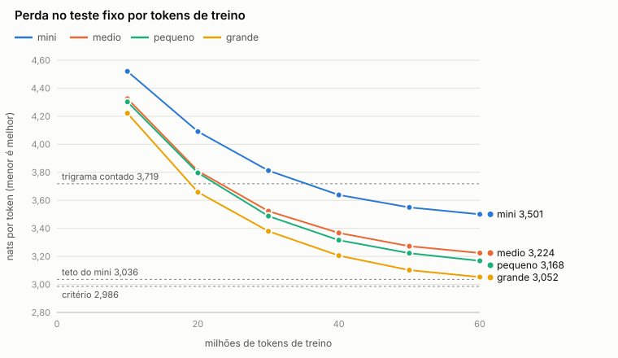
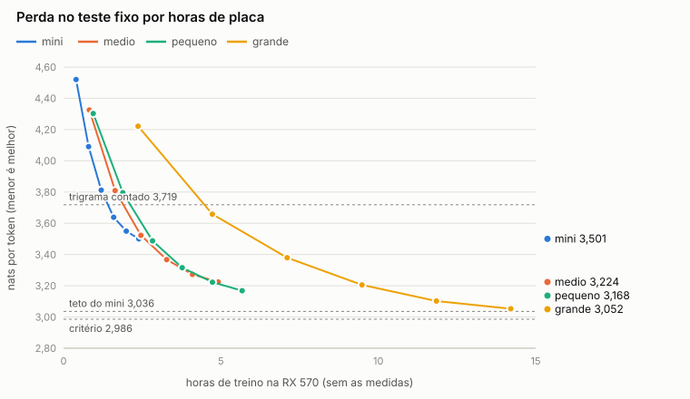
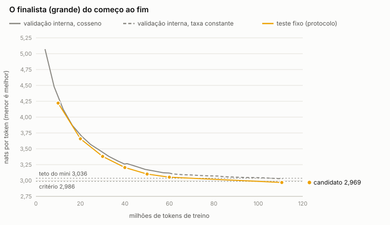

# Fase 2 — Estudo de escala e cérebro candidato

K.E.R.N.E.L 0.5.1 · 16 a 18/10/2026 · branch `estabilizacao-0.5`

**Resultado:** o cérebro candidato é o tamanho **grande** (40,1 milhões de parâmetros, 12 camadas × 512). Ele mede **2,969 nats por token no teste fixo** (1,323 bits por byte); o teto do mini, medido na mesma rodada, faz 3,036.

- **Critério de perda:** o pedido era 2,986 ou menos, e o candidato tem 0,017 de folga. O ganho contra o mini é 0,067.
- **Portão:**
  - O candidato carrega e responde pelo serviço.
  - A inferência em NumPy confere com o PyTorch (diferença de 2·10⁻⁵).
  - Ele gera 49 tokens por segundo na CPU (o mínimo pedido é 20).
  - Os 375 testes passam (um é pulado, como antes).
- **O que falta:**
  - **A avaliação às cegas**, que decide os critérios de coerência, assunto e português. As notas do Claude foram gravadas antes de abrir a chave (commit `0c0e419`); faltam as do Henrique.
  - **A repetição do ganho numa segunda semente.** Ela foi cancelada pelo Henrique no meio, para a continuação usar o resto do orçamento.

O plano foi registrado num commit antes do primeiro treino ([plano.md](plano.md)). Tudo o que mudou depois está na seção "Alterações depois do registro" de lá, com data.

## A comparação de escala (60 milhões de tokens)

Os quatro tamanhos treinaram do zero do mesmo jeito:
- **dados:** o mesmo corpus, na mesma ordem (passada sem repetição, semente 1337);
- **taxa:** a mesma (sobe por 200 passos até 6e-4 e desce em cosseno até 6e-5);
- **passo:** 8.192 tokens, por 7.325 passos.

Os pesos foram guardados a cada 10 milhões de tokens e medidos depois, pelo protocolo, no teste fixo. Cada medida rodou num processo à parte.

| Tamanho | Parâmetros | Camadas × dimensão | Teste em 60 mi | Bits por byte | Contra o mini | Horas de treino |
|---|---|---|---|---|---|---|
| mini | 3,5 mi | 6 × 192 | 3,501 | 1,560 | — | 2,4 |
| medio | 11,3 mi | 8 × 320 | 3,224 | 1,437 | −0,276 | 4,9 |
| pequeno | 15,9 mi | 8 × 384 | 3,168 | 1,412 | −0,332 | 5,7 |
| **grande** | 40,1 mi | 12 × 512 | **3,052** | **1,361** | **−0,448** | 14,2 |
| *trigrama contado* | | | *3,719* | *1,658* | | |
| *teto do mini (Fase 1.5)* | 3,5 mi | 6 × 192 | *3,036* | *1,353* | | *~21 h, 524 mi de tokens* |

Todos os números de perda foram **medidos**.



- **Com os mesmos tokens, tamanho compra muito.** O grande em 60 milhões de tokens quase empata com o teto do mini, que leu 524 milhões. Ou seja: o mesmo resultado com ~9 vezes menos texto.
- **Não há sinal de saturação até 40 mi.** Cada aumento de tamanho ganhou em todos os marcos, desde os 10 milhões de tokens.
- **O medio e o pequeno ficam perto um do outro** (0,056 de diferença): os dois têm 8 camadas e só a largura muda. O grande é mais largo e mais fundo ao mesmo tempo, então esta comparação não separa uma coisa da outra. As variações de largura, profundidade e contexto ficaram de fora por falta de orçamento, como previsto no plano.

### A mesma conta em horas de placa

Aqui a ordem se inverte. Os números são **estimativas** (uma reta entre dois marcos medidos), com duas ressalvas:

- **Os marcos intermediários não são o fim de um treino.** Eles estão no meio do cosseno, com a taxa ainda alta; só o de 60 milhões terminou de descer a taxa. Comparar em horas iguais favorece o mini, o único que chega ao fim do cosseno nesse tempo.
- **O grande rodou com lote 2.** Com lote 4 faltou memória de vídeo (ver "O que deu errado"), e com lote 2 ele faz ~1.180 tokens/s em vez de ~1.770.

| Tamanho | Teste em 2,4 h (o tempo do mini inteiro) | Horas até a perda final do mini (3,501) |
|---|---|---|
| mini | 3,501 (medido) | 2,4 (medido) |
| medio | ~3,55 | ~2,6 |
| pequeno | ~3,63 | ~2,8 |
| grande | ~4,22 | ~6,1 |



**Leitura:** nesta placa, cada hora rende menos num modelo maior, mas o teto de um modelo maior é mais baixo. O mini precisou de ~21 h para chegar a 3,036. O grande chegou a 2,969 com ~26 h, contando a continuação. Para quem quer o melhor cérebro e não o mais barato, o maior que cabe é o certo.

### Uma lei de potência (estimativa)

Com os quatro tamanhos em 60 milhões de tokens, o ajuste é L(N) ≈ 2,835 + 1,184 · N^−0,46, com N em milhões de parâmetros. São quatro pontos para três números, então o ajuste quase não é testado. Fica como ordem de grandeza:
- um modelo de 80 milhões faria ~2,99 com os mesmos 60 milhões de tokens;
- um de 120 milhões faria ~2,97.

Nenhum dos dois cabe na RX 570: o grande já é o limite (ver a seção de memória de vídeo).

## O finalista e a continuação

- **Escolha do finalista:** a regra do plano (a menor perda em 60 milhões de tokens; um empate a menos de 0,01 iria para o menor) escolheu o grande, com 0,116 à frente do pequeno.
- **Ponto de partida:** a continuação partiu do marco de 60 milhões, do jeito registrado no plano: sem reaquecer, com taxa constante de 3e-5 e a passada seguindo de onde estava.
- **Duração:** 12,1 h, em dois trechos (5,7 h e 6,4 h), com uma pausa no meio a pedido do Henrique. Ela parou pelo fim do tempo, não por estagnação.



| | Marco de 60 mi | Candidato |
|---|---|---|
| Passo | 7.325 | 13.500 |
| Tokens lidos | 60,0 mi | 110,6 mi |
| Teste fixo (protocolo) | 3,052 | **2,969** |
| Validação interna do treino (40 janelas) | 3,118 | 3,028 |

- **Medido e não medido:** no gráfico, a linha amarela liga medidas do protocolo. Entre 60 e 110 milhões de tokens não houve medida, só os dois pontos das pontas.
- **Validação interna:** a linha cinza é a do treino (40 janelas, porque o número de janelas acompanha o lote). Ela é a régua de bolso do treino, não a da fase.
- **O candidato** é o modelo de melhor validação interna, o passo 13.500. A continuação acabou no 13.544.
- **Tendência no fim:** a validação interna ainda caía ~0,007 por hora. O teto do grande não foi atingido (estimativa).

## O candidato contra o teto do mini

Os dois foram medidos pelo protocolo v2 na mesma rodada (`candidato/` e `teto-mini/`).

| Conjunto | Teto do mini | Candidato | Diferença |
|---|---|---|---|
| Teste fixo | 3,0360 (1,353 bits/byte) | **2,9686 (1,323)** | −0,067 |
| Validação fixa | 3,0598 | 2,9941 | −0,066 |
| Amostra já lida no treino | 3,0397 | 2,9840 | −0,056 |
| Validação antiga | 3,0481 | 2,9955 | −0,053 |

- **Ele não decorou o que leu:** no texto já lido ele faz 2,984, quase o mesmo que no nunca lido (2,969).
- **Reprodutibilidade da régua:** o teto do mini, medido de novo, deu os mesmos 3,0360 da Fase 1.5.

Perda por posição na janela:

| Posições | 1 | 2–4 | 5–16 | 17–64 | 65–128 | 129–256 |
|---|---|---|---|---|---|---|
| Teto do mini | 5,135 | 3,920 | 3,394 | 3,139 | 3,011 | 2,939 |
| Candidato | **4,935** | **3,797** | **3,339** | **3,076** | **2,948** | **2,869** |

**Ele ganha em todas as faixas, e mais no contexto curto** (−0,20 com um token só). Na Fase 1.5, mais treino no mini só melhorava o contexto longo; aqui a capacidade a mais aparece onde o mini não alcançava. Mesmo assim, com um token de contexto ele ainda perde para um bigrama contado (4,60).

**O preço:**

| | Teto do mini | Candidato |
|---|---|---|
| Geração na CPU (NumPy, um token por vez) | ~250 tokens/s | **~49 tokens/s** |
| Pesos | 13,4 MB | 152,8 MB |
| RAM de pico (protocolo) | 388 MB | 796 MB |

No serviço, o "completa: ..." do candidato levou 1,9 s, contra 0,8 s do mini.

## A segunda semente

O plano previa repetir o treino de comparação do finalista com a semente 2026 até os 60 milhões de tokens.

- **O cancelamento:** em 18/10, o Henrique decidiu cancelar essa repetição para a continuação ficar com o resto das 48 h. Ela parou no passo 1.704 de 7.325, com o checkpoint salvo (`dados/fase2/escala/grande-s2026`).
- **O único marco medido** (10 milhões de tokens):

  | Semente | Teste em 10 mi | Vantagem sobre o mini no mesmo ponto |
  |---|---|---|
  | 1337 | 4,221 | 0,299 |
  | 2026 | 4,255 | 0,265 |

- **Leitura:** nas duas sementes, o grande está bem à frente do mini. A diferença entre elas (0,034) é grande perto da margem do critério (0,05). Mas isso foi medido cedo, quando a perda ainda cai rápido, e não diz o tamanho do ruído em 60 milhões. Na Fase 1.5, no mini, sementes diferentes deram 0,002 de diferença.
- **Conclusão:** **o critério 1 está cumprido sem a repetição combinada.** Para fechá-lo, falta terminar a segunda semente: ~10,8 h de treino e ~1,5 h de medidas, retomando do checkpoint com `escala.py --tamanhos grande --semente 2026 --continuar`.

## A avaliação às cegas

- **Textos:** 96, os 12 começos fixos × 4 jeitos de gerar (o do serviço e o sorteio cru, duas sementes cada) × 2 modelos (o candidato e o teto do mini).
- **Embaralhamento:** os textos foram embaralhados com códigos em [`cegas/cegas.md`](cegas/cegas.md).
- **Rubrica:** [a da Fase 1.5](../fase15/rubrica.md).
- **Notas do Claude:** gravadas em `cegas/notas-claude.json` e num commit (`0c0e419`) antes de qualquer pessoa abrir `cegas/chave.json`. O Claude também não abriu os relatórios do candidato e do teto, onde os textos aparecem com o nome do modelo.
- **Uma ressalva:** 24 dos 48 textos do teto são idênticos aos que o Claude pontuou na Fase 1.5 (mesmo modelo, mesmos começos, mesmas sementes). Ele contou isso depois de gravar as notas. Na hora de pontuar não reconheceu nenhum com segurança, mas para ele a avaliação é às cegas só em parte.
- **Notas do Henrique:** pendentes, em `cegas/notas-henrique.json`. Depois delas, `python docs/fase2/cegas.py --revelar` abre a chave e confere os critérios 2 a 4.

**Até lá, não dá para dizer se a perda menor virou texto melhor.** Na Fase 1.5 não virou.

## Portão de saída

| Exigência | Situação |
|---|---|
| Perda no teste ≤ 2,986 | **Sim:** 2,969 |
| O ganho se repete numa segunda semente | **Não verificado:** cancelada por decisão do Henrique. No único ponto medido, as duas sementes ficam à frente do mini |
| Coerência ≥ 25%, assunto ≥ 50%, português no máximo 10 pontos abaixo do mini | **Pendente:** as notas do Henrique |
| Sem regressão nos testes | **Sim:** 375 testes, 374 passam e 1 é pulado (o mesmo de antes: o Windows não deixa criar atalho simbólico sem ser administrador). Linhas de teste trocadas: 3, todas mais exigentes que as antigas (a contagem de textos do protocolo v2, e um teste de retomada que ficou determinístico) |
| Carrega e responde no serviço pela inferência NumPy | **Sim:** um serviço de verdade, numa porta à parte, com uma cópia do candidato. Subiu em 12,6 s e respondeu ao "completa: ..." em 1,9 s ([portao.json](portao.json)) |
| NumPy conferido contra o PyTorch | **Sim:** 1,5 a 2,4·10⁻⁵ em quatro janelas do teste fixo, o mesmo token mais provável em todas as posições |
| ≥ 20 tokens por segundo na CPU | **Sim:** 49,2 (mediana de 5 medidas de 200 tokens) |

## O cérebro candidato

- **Pesos:** `dados/fase2/candidato/cerebro/modelo.npz`, 152,8 MB, fora do Git.
- **Impressão SHA-256:** `79c86f632b9f326d9c926a78888fdf5fd7db733e0a6b80f7d485c898a5fdcad3` (também em `modelo.npz.sha256`).
- **Para continuar treinando:** o checkpoint fica na mesma pasta, com o otimizador e a posição da passada.
- **O serviço ainda usa o teto do mini.** Instalar o candidato depende do Henrique e pede o serviço desligado: `python -m kernel cerebro instalar --de dados\fase2\candidato\cerebro`. Ele faz uma cópia de segurança antes.
- **Por que esperar:** a resposta fica ~5 vezes mais lenta, e a avaliação às cegas ainda não disse se o texto melhorou.

## Tempo de placa

O orçamento era de 48 h de placa, contadas desde 16/10 às 19:30. As duas pausas pedidas pelo Henrique (15 min em 17/10 e 3,5 h em 18/10) não contam. O último uso da placa acabou às 22:59 de 18/10, com ~47,7 h.

| Etapa | Horas | Previsto |
|---|---|---|
| Medidas do limite da placa e comparação dos quatro tamanhos, com as medidas | 31,5 | ~23,5 |
| Segunda semente (cancelada no passo 1.704) | 3,3 | 5 a 9 |
| Continuação do grande | 12,1 | ~15 |
| Medidas finais (os protocolos do candidato e do teto, e o marco da segunda semente) | 0,8 | ~1 |

A comparação levou 8 h a mais que o previsto. Desse total, 4,8 h vieram do grande com lote 2. O resto foi das medidas, mais lentas que o previsto (cada marco do grande leva ~13 min, e o protocolo completo dele ~27 min), e do pequeno com lote 4.

## O que deu errado

- **17/10, 04:30 — falta de memória de vídeo:** o pequeno e o grande falharam logo no começo.
  - **Causa:** cada um começou no mesmo segundo em que o processo anterior terminava, antes de a placa devolver a memória.
  - **Efeito em cadeia:** o pipeline do finalista começou sozinho com só dois tamanhos prontos, escolheu o medio e lançou a segunda semente dele. Interrompi em 10 minutos.
  - **Correção:** o script espera a placa liberar entre processos e tenta de novo se faltar memória no começo. O finalista passou a exigir os quatro tamanhos.
- **O grande não coube com lote 4:** em 16/10 ele coube, mas com pico de 3,2 GB numa placa de 4 GB. Depois faltou memória três vezes.
  - Com lote 2 × 16 a conta é a mesma (8.192 tokens por passo, na mesma ordem); muda só a velocidade.
  - **Ressalva:** o grande é o maior que esta placa treina, e ainda assim no limite.
- **Pausas no meio de treinos:** parar um treino de comparação no meio recomeçava a curva da taxa. A opção nova `--sessao-desde` continua a sessão como ela seria sem a parada. Um teste mostra que parar e retomar dá os mesmos pesos de quem não parou.

## Recomendação

1. **O grande é o cérebro candidato.**
   - **Ganhos:** é o único tamanho que passou o critério de perda, e com a mesma quantidade de texto todo aumento de tamanho rendeu.
   - **Limite:** é também o maior que a RX 570 treina, com lote 2 e ~1.180 tokens/s.
   - **Fora de alcance:** tamanhos maiores ficam para outra placa ou para a nuvem, decisão que não foi tomada.
2. **Antes de instalar, a avaliação às cegas.** É ela que diz se 0,067 de perda a menos virou texto com sentido. Se não virou, o próximo passo não é mais tamanho, e sim olhar o corpus e a avaliação de conversa.
3. **Fechar a repetição:** terminar a segunda semente (~12 h de placa, com as medidas) quando houver tempo, para o critério 1 valer por inteiro.
4. **Mais treino ainda rende:**
   - a validação interna caía ~0,007 por hora no fim;
   - a passada leu só 14,4% do corpus;
   - a continuação pode seguir do checkpoint, pelo serviço ou pela linha de comando.
5. **Depois:**
   - o experimento de corpus (um corpus mais simples em português, com fonte e licença verificadas antes de baixar);
   - as variações de largura, profundidade e contexto no grande, uma de cada vez.

## Como reproduzir

```
.venv\Scripts\python.exe docs\fase2\medir_placa.py --tamanhos mini medio pequeno grande
.venv\Scripts\python.exe docs\fase2\escala.py --tamanhos mini medio pequeno grande
.venv\Scripts\python.exe docs\fase2\finalista.py --inicio "2026-10-16 19:30" --orcamento 48
.venv\Scripts\python.exe docs\fase2\curvas.py
.venv\Scripts\python.exe docs\fase2\portao.py --modelo dados\fase2\candidato\cerebro\modelo.npz --saida docs\fase2\portao.json
.venv\Scripts\python.exe docs\fase2\cegas.py --revelar
```

- **Pausas:** com pausas, `escala.py --continuar` e `finalista.py --continuar-candidato` seguem de onde pararam, e `--inicio` vai para a frente pela duração da pausa.
- **Arquivos gerados:**
  - os relatórios de cada marco estão em `escala/<tamanho>/`;
  - todos os pontos estão em `escala/curvas.json`, cada número marcado como medido ou estimado;
  - os protocolos do candidato e do teto estão em `candidato/` e `teto-mini/`.
